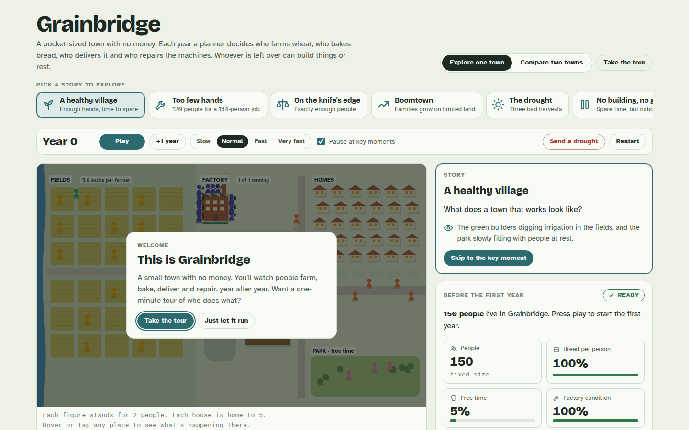

# City Economy Simulator

**A modular simulator of a closed city economy, built in 11 stages. It starts as four sectors with a central planner and no money. Each stage adds one historical institution (money, banks, competition, government, a central bank, financial markets, trade, technology) to show what problem it solved and what new failure it introduced.**



**Highlights**
- **Layered architecture.** Every mechanism is a plugin layer with its own parameters, hooks, invariants and metrics, and can be switched on or off in YAML config. With later layers off, earlier stages reproduce their results exactly (golden regression tests).
- **Stock-flow consistent.** A double-entry ledger records every good and every unit of money, and engine invariants are checked on every tick.
- **Experiments and reports.** Each stage has scripted experiments (sweeps, multi-seed runs, comparisons) that generate an HTML report in [`reports/`](reports/).
- **Grainbridge town twin.** An animated, narrated view of the Stage 1 economy for non-specialists. Its JavaScript engine is checked tick by tick against the Python model to 1e-9.
- **178 tests:** unit tests, invariant tampering, analytical checks, golden regressions and twin parity.

**Built with Claude Code** from a written specification ([`SPEC.md`](SPEC.md)) under strict working rules: build one stage at a time, run its experiments, report and stop for review. Every ambiguous design choice is recorded in [`DECISIONS.md`](DECISIONS.md), and stage-by-stage results are in [`STAGES.md`](STAGES.md).

## Stages

| # | Stage | Report |
|---|---|---|
| 1 | Real economy baseline (planner, no money) | [stage_1.html](reports/stage_1.html) |
| 2 | Barter, money and prices | [stage_2.html](reports/stage_2.html) |
| 3 | Credit and banking | [stage_3.html](reports/stage_3.html) |
| 4 | Many firms, competition and specialization | [stage_4.html](reports/stage_4.html) |
| 5 | Government and public goods | [stage_5.html](reports/stage_5.html) |
| 6 | Central bank and monetary policy | [stage_6.html](reports/stage_6.html) |
| 7 | Financial markets and risk sharing | [stage_7.html](reports/stage_7.html) |
| 8 | Trade between cities | [stage_8.html](reports/stage_8.html) |
| 9 | Technology and long-run growth | [stage_9.html](reports/stage_9.html) |
| 10 | The modern economy and comparing allocation systems | [stage_10.html](reports/stage_10.html) |
| 11 | The modern town and the internet | [stage_11.html](reports/stage_11.html) |

Reports are self-contained HTML files. Download one and open it in a browser.

## Run

Requires Python 3.11+.

```sh
python -m venv .venv && source .venv/bin/activate
pip install -e ".[dev]"

python -m citysim run scenarios/stage1_base.yaml          # single run
python -m citysim sweep scenarios/stage1_base.yaml --param a=1:10:0.5
python -m citysim compare scenarios/stage10_modern.yaml scenarios/stage10_planned.yaml
python -m citysim experiments stage10                      # regenerate a stage report
python -m citysim twin                                     # build reports/grainbridge.html

pytest                                                     # full test suite (~2.5 min)
```

## Layout

```text
citysim/core/          World, double-entry Ledger, 9-phase Scheduler, Layer interface, Recorder, runner
citysim/layers/        One package per stage (s1_real_economy … s11_modern_town)
citysim/experiments/   Scripted experiments that produce each stage report
scenarios/             YAML scenarios with inherits: deep-merge
twin/                  Grainbridge animated town (JS port of the Stage 1 rules)
tests/                 Unit, invariant, analytical, golden regression and twin-parity tests
```

**Stack:** Python, numpy, pandas, pydantic, PyYAML, Plotly and pytest.

> A teaching model with deliberately simple, transparent rules. It is not a forecasting tool.
